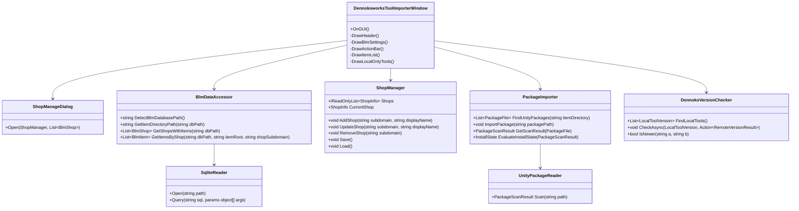

# dennokoworks Tool Importer (BLM連携) 実装計画書

## 0. レビュー結果と修正点 (2026-10-18)
初版計画を実環境（BLM `data.db` schema_version=20260114、`K:\Booth_DL`、`Assets/dennokoworks/*`）と突き合わせ、以下を修正した。

| # | 初版の記述 | 実態 / 問題 | 修正方針 |
|---|---|---|---|
| 1 | `preferences.item_directory_path` からパス取得 | 列型は **BLOB** で、中身は **UTF-16LE** 文字列（例: `K\0:\0\\\0...`） | BLOB の場合は UTF-16LE としてデコード（UTF-8 / TEXT にもフォールバック） |
| 2 | 保存先は `b<booth_item_id>/` | フォルダ名は `registered_items.id`（現状 `b<booth_item_id>` と一致） | `registered_items.id` をそのままフォルダ名として使う |
| 3 | `b<id>/` 配下の `.unitypackage` を探索 | 実際は `b<id>/<展開フォルダ>/xxx.unitypackage` とサブフォルダの奥にあり、**複数バージョン**（`_v1.0.0`, `_v1.1.0`…）が共存する | 再帰探索し、ファイル名またはフォルダ名からバージョンを抽出して新しい順に並べる。最新版を既定のインポート対象にする |
| 4 | 「SQLite 接続またはフォールバック読み込み」 | Unity 標準に SQLite は無い。ネイティブ DLL を同梱すると配布が重くなる | OS 同梱の SQLite を P/Invoke で使う（Windows: `winsqlite3.dll`、macOS: `/usr/lib/libsqlite3.dylib`）。**読み取り専用**で開き、BLM 起動中などでロックされている場合は一時フォルダへコピーして読む |
| 5 | `CheckIfInstalled(string toolName)` | ツール名ではアセットと紐付けられない（BOOTH 商品名は装飾が多い） | `.unitypackage`（tar.gz）を解析して **アセット GUID 一覧** を取得し、`AssetDatabase.GUIDToAssetPath` で導入率を判定（導入済み / 一部導入 / 未導入）。解析は別スレッドで行い、結果は `Library/` にキャッシュする |
| 6 | バージョンチェックは「BLM 側の更新日時またはファイル名との比較」(フェーズ4) | 2.4 節（GitHub の version.json 比較）と矛盾 | 2.4 節を正とする。比較対象は **ローカル / BLM 内パッケージ / GitHub** の3者（詳細 2.4） |
| 7 | GitHub リポジトリ名＝ツール名の前提 | `DennokoPSDEditor` の repo は `PSDSimpleEditor` など不一致がある | ローカル version.json の `url` フィールド（`https://github.com/{owner}/{repo}/releases`）から owner/repo を抽出する |
| 8 | `Application.OpenURL("https://dennoko.booth.pm/")` | ショップのサブドメインは `dennokoworks` | `https://{subdomain}.booth.pm/` を開く |
| 9 | 設定の永続化先が未確定 | ショップ一覧はプロジェクトを跨いで共通の方が便利 | ショップ一覧・BLM パス上書きは `EditorPrefs`（ユーザー単位）、パッケージ解析キャッシュは `Library/`（プロジェクト単位）に保存 |
| 11 | version.json の `url`（GitHub Releases）への導線 | ツールの配布は BOOTH のみ。ユーザーに GitHub を認知させない方針 (2026-10-18 追記) | GitHub は最新バージョンの取得元としてのみ内部で使う。UI・ログ・README に GitHub / owner / repo を出さず「最新」と表記する。更新の案内先は BOOTH（アイテム / ショップページ）と BLM のみ |
| 12 | BOOTH 商品ページへの導線 | BLM の DB に商品 URL の列は無い（BLM は `booth_items.id` から URL を組み立てていると考えられる） | `https://{shop_subdomain}.booth.pm/items/{booth_items.id}` を DB の値から組み立てて使う |
| 10 | BLM に登録されているがショップ情報の無いアイテム | `registered_items.booth_item_id` が NULL のユーザー登録アイテム（`user_item_info`）が存在しうる | ショップ単位の表示対象外とする |

---

## 1. 概要と目的
本ツールは、BOOTH Library Manager (BLM) でダウンロードされた各種 BOOTH アイテム（特に Unity 拡張ツール）を Unity プロジェクト内からスムーズにインポートできるようにするエディタ拡張機能です。

- **デフォルト対象**: `dennokoworks` の各種ツール
- **柔軟なショップ対応**: ユーザーが任意のショップを追加・切り替えて、該当ショップのツール/アセットも同様にインポート可能
- **バージョンチェック**: `dennokoworks` 製ツールのみを対象とし、最新バージョン情報の取得・更新通知を行う

---

## 2. 要件定義

### 2.1 BLM (BOOTH Library Manager) 連携要件
1. **BLM 自動検出 & パス設定**
   - 標準パスの存在確認
     - Windows: `%APPDATA%\pm.booth.library-manager\data.db`
     - macOS: `~/Library/Application Support/pm.booth.library-manager/data.db`
   - `data.db` の `preferences.item_directory_path`（UTF-16LE の BLOB）から、アイテム保存先パスを自動取得
   - DB パス・保存先パスとも手動指定による上書きをサポート（`EditorPrefs` に保存）
2. **アイテム・ショップデータ取得**
   - `shops`, `booth_items`, `registered_items`, `overwritten_booth_items`（ユーザーが上書きした名前）を参照
   - アイテム保存先は `[保存先]/<registered_items.id>/`。配下を再帰的に探索して `.unitypackage` を列挙
   - DB は読み取り専用で開く。開けない場合は一時コピーを読む

### 2.2 ショップ切り替え・追加機能要件
1. **デフォルトショップ**
   - 初期状態では `dennokoworks`（サブドメイン: `dennokoworks`）が選択。デフォルトショップは削除不可
2. **ショップ切り替え UI**
   - ヘッダーのショップ名ボタンをクリックすると `GenericMenu` で登録済みショップ一覧を表示し、選択すると即座に表示アイテムを切り替える
3. **ユーザーによるショップ追加・管理**
   - 「＋ ショップ追加」からショップ管理ダイアログを開く
   - BLM の `shops` テーブルのうち **登録アイテムを1件以上持つショップ** を検索付きリストでサジェスト、またはサブドメインと表示名を直接入力して登録
   - 追加したショップは `EditorPrefs` に JSON で永続化
   - 表示名の編集・削除が可能

### 2.3 インポート機能要件
1. **アイテム一覧表示**
   - 選択中ショップの BLM 登録アイテムについて、名前・サムネイル（`thumbnail_url` を非同期取得しメモリキャッシュ）・状態を表示
   - 状態: `パッケージなし`（.unitypackage が無い／zip 未展開など） / `解析中` / `未導入` / `一部導入` / `導入済み`
   - 名前による検索フィルター
2. **ワンクリックインポート**
   - 「インポート」ボタンで最新パッケージを `AssetDatabase.ImportPackage(path, interactive: true)` で実行
   - 複数パッケージがある場合はボタン横のドロップダウン（`GenericMenu`）で別バージョン/別パッケージを選択可能
   - インポート完了（`AssetDatabase.importPackageCompleted`）時に状態を再計算
3. **まとめてインポート**
   - 「複数選択モード」チェックボックスをオンにすると、各アイテムにチェックボックスと「まとめてインポート (N 件)」ボタンを表示
   - 「すべて選択」「更新ありを選択（dennokoworks のみ）」「選択解除」。▼ で各アイテムのインポート対象パッケージを切り替え可能
   - `ImportQueue` が 1 件ずつ順に `AssetDatabase.ImportPackage` を実行する。`importPackageCompleted / Cancelled / Failed` を受けて次へ進み、コンパイル中・アセット更新中は待機する
   - スクリプトを含むパッケージのインポートでドメインリロードが起きても継続できるよう、キューの状態は `SessionState` に保存して `[InitializeOnLoad]` で再開する
   - 既定は非対話（ダイアログなし）。「内容を確認しながら」をオンにすると 1 件ずつインポートダイアログを表示
   - 進行状況バー、「現在の項目をスキップ」「残りを中止」、完了後の結果（成功 / キャンセル / 失敗）を表示。実行中は単体インポートを無効化
4. **導入済み判定**
   - `.unitypackage` を gzip + tar として読み、`<guid>/` エントリから GUID 一覧、`<guid>/pathname` からアセットパスを取得
   - プロジェクト内に存在する GUID の割合で判定（≥80%: 導入済み、>0%: 一部導入、0%: 未導入）
   - 解析結果はファイルパス＋サイズ＋更新日時をキーに `Library/DennokoworksToolImporter/package_cache.json` へキャッシュ

### 2.4 バージョンチェック機能要件（※ dennokoworks 限定）
dennokoworks のツールは基本的に `Assets/dennokoworks/<ツール>/` に配置される。一部のツールには `version.json`（`{"version","url","message"}`）が配置されており、GitHub 公開リポジトリの main / master ブランチにある version.json と比較することでツール内にアップデート情報を表示する仕組みがある。

本ツールではこれを利用し、以下の3つを比較する。
- **ローカル**: `Assets/dennokoworks/<ツール>/version.json`
- **BLM**: BLM 内の `.unitypackage` に含まれる version.json（パッケージ解析時に抽出）。無ければファイル名のバージョン
- **GitHub**: ローカル version.json の `url` から owner/repo を抽出し、`https://raw.githubusercontent.com/{owner}/{repo}/{main|master}/version.json` を取得（main → master の順にフォールバック。403/429 はフォールバックしない）

判定と表示:
- BLM > ローカル: 「更新をインポート (vX)」ボタンを強調表示
- 最新 > BLM（かつ 最新 > ローカル）: 「新しいバージョンがあります。BLM で最新版をダウンロードしてください」と案内（BOOTH の商品ページを開くボタン付き）
- それ以外: 最新
- BLM に対応アイテムが無い version.json 付きツールも「その他の導入済みツール」として一覧に出し、最新バージョンとの比較結果と BOOTH ショップへのボタンを表示する
- ローカルツールと BLM アイテムの紐付けは、パッケージ内のパス `Assets/dennokoworks/<ツール>/...` から行う
- GitHub への問い合わせは「最新バージョン確認」ボタン押下時のみ行い、結果は `SessionState` にキャッシュする（レート制限対策）
- **表示方針**: 配布は BOOTH のみのため、UI・コンソールログでは取得元（GitHub / owner / repo / URL）を一切出さず「最新」と表記する。version.json の `url` は開かない。更新の案内は「BLM で最新版をダウンロード」「BOOTH を開く」に限る

---

## 3. アーキテクチャ設計

### 3.1 クラス構成・責務設計



### 3.2 ディレクトリ構成
```
Packages/com.dennokoworks.tool-importer/
├── Docs/
│   └── Impl/
│       └── implementation_plan.md      # 本実装計画書
├── Editor/
│   ├── Dennokoworks.ToolImporter.Editor.asmdef
│   ├── Windows/
│   │   ├── DennokoworksToolImporterWindow.cs   # メインウィンドウ
│   │   └── ShopManageDialog.cs                 # ショップ追加・編集ダイアログ
│   ├── Core/
│   │   ├── SqliteReader.cs                     # OS 同梱 SQLite の P/Invoke ラッパー（読み取り専用）
│   │   ├── BlmDataAccessor.cs                  # BLM DB・ファイル読み込み
│   │   ├── ShopManager.cs                      # ショップ管理・永続化
│   │   ├── UnityPackageReader.cs               # .unitypackage (tar.gz) 解析
│   │   ├── PackageImporter.cs                  # .unitypackage 検出・導入判定・インポート
│   │   ├── ImportQueue.cs                      # まとめてインポートの順次実行キュー
│   │   ├── ThumbnailCache.cs                   # サムネイル非同期取得
│   │   └── DennokoVersionChecker.cs            # dennokoworks 専用バージョン判定
│   └── Models/
│       ├── BlmShop.cs                          # ショップデータモデル（BLM 側 / 登録側）
│       ├── BlmItem.cs                          # アイテムデータモデル
│       └── ToolItemState.cs                    # パッケージ・導入状態・バージョン情報
├── package.json
└── README.md
```

---

## 4. UI / UX 設計

### 4.1 メインウィンドウのレイアウトイメージ
```
+-------------------------------------------------------------+
| ショップ: [ dennokoworks ▼ ]   [＋ ショップ追加] [⚙ 設定]   |
+-------------------------------------------------------------+
| (⚙ 展開時) BLM DB: C:\...\data.db       [参照...] [自動]    |
|            保存先: K:\Booth_DL          [参照...] [自動]    |
|-------------------------------------------------------------|
| [ 最新バージョン確認 ]  [ 一覧を再読み込み ]  検索: [____]   |
+-------------------------------------------------------------+
| アイテム一覧 (dennokoworks): 8件                             |
| +---------------------------------------------------------+ |
| | [ICON] DennokoEx                                        | |
| |        (※ 更新がある場合のみメッセージを表示)             | |
| |                         [ 更新をインポート ][▼]           | |
| +---------------------------------------------------------+ |
| | [ICON] MaskMaker                                        | |
| |                         [ 再インポート ][▼]               | |
| +---------------------------------------------------------+ |
| | [ICON] Uni-Blocks                                       | |
| |                         [ インポート ][▼]                 | |
| +---------------------------------------------------------+ |
| その他の導入済みツール                                       |
| | DenLattice                                      [BOOTH]  |
+-------------------------------------------------------------+
```

### 4.2 任意ショップ選択時
- バージョン確認ボタン・更新通知・「その他の導入済みツール」は非表示
- 導入状況はボタン（インポート／再インポート）の表記のみで自明にし、余分なラベルは表示しない

---

## 5. 実装ステップ

### フェーズ 1: BLM データアクセス基盤
- `SqliteReader.cs`: winsqlite3 / libsqlite3 の P/Invoke（open_v2 readonly, prepare_v2, bind_text, step, column_*）
- `BlmDataAccessor.cs`: DB 自動検出、保存先取得（BLOB デコード）、ショップ・アイテム取得、ロック時の一時コピー

### フェーズ 2: ショップ管理
- `ShopManager.cs` / モデル: デフォルト `dennokoworks`、追加・編集・削除、`EditorPrefs` 永続化
- `GenericMenu` によるショップ切り替え、`ShopManageDialog`

### フェーズ 3: パッケージインポート
- `UnityPackageReader.cs`: tar.gz の逐次読み込み（ustar / GNU longname / pax path 対応）
- `PackageImporter.cs`: 再帰探索、バージョン抽出・並べ替え、バックグラウンド解析とキャッシュ、導入判定、インポート

### フェーズ 4: dennokoworks 限定バージョンチェック
- `DennokoVersionChecker.cs`: ローカル version.json 走査、GitHub raw 取得（main→master）、バージョン正規化比較
- ウィンドウでの3者比較表示

### フェーズ 5: UI ブラッシュアップ & エラーハンドリング
- BLM 未インストール／DB 読み込み失敗／保存先未設定時のガイダンス
- 検索フィルター、サムネイル表示

---

## 6. 検証・テスト計画
※ 実装時の確認はコンパイル（構文）チェックのみ。Unity 上の動作確認は作者が実施する。

1. **BLM 自動検出テスト**: `%APPDATA%\pm.booth.library-manager\data.db` から保存先 `K:\Booth_DL` と `dennokoworks` のアイテム（8件）が読み出せること
2. **ショップ切り替えテスト**: `dennokoworks` から他ショップへ切り替えた際に該当アイテム一覧が表示されること。追加・削除がエディタ再起動後も保持されること
3. **インポート動作テスト**: 最新パッケージおよびドロップダウンで選んだパッケージがインポートでき、完了後に状態が「導入済み」に変わること
4. **バージョンチェック制約テスト**: `dennokoworks` 選択時のみバージョン関連 UI が表示されること。DennokoPSDEditor（repo 名不一致）が正しく照会されること
