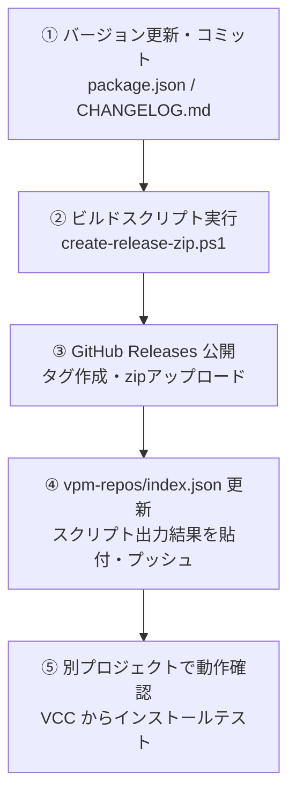

# VPM パッケージ リリース手順書 (RELEASE.md)

本ドキュメントは、**dennokoworks Tool Importer** を VPM パッケージとしてリリース（新規公開・バージョンアップ）する手順をまとめた運用マニュアルです。

ヒューマンエラー（不要ファイルの混入、ZIPの階層構造ミス、ハッシュ計算ミス、URLの記載ミス）を防ぐため、**自動ビルドスクリプト** を使用した手順に統一されています。

---

## リリース作業フロー概要



---

## ステップ 1: バージョン番号の更新とコミット

1. **`package.json` のバージョンを更新する**
   ```json
   "version": "0.1.0"
   ```
2. **`CHANGELOG.md` に更新内容を追記する**
3. **Git にコミットしてリモート（GitHub）へプッシュする**
   ```bash
   git add .
   git commit -m "Release v0.1.0"
   git push origin master
   ```

---

## ステップ 2: リリース用 ZIP の自動ビルド

リポジトリルートでビルドスクリプトを実行します。

### Windows (PowerShell) の場合
```powershell
.\create-release-zip.ps1
```

### Git Bash / macOS / Linux の場合
```bash
./create-release-zip.sh
```

### スクリプトが自動で行う処理
- `package.json` からパッケージ名とバージョン番号を自動読み取り
- **`.git/` や不要な中間ファイル（`.vs/`, `*.zip`, スクリプト自身）を確実に除外**
- **VPM 仕様に準拠した形式（ZIP のルート直下に `package.json` を配置）で自動圧縮**
- パッケージの出力先: `Packages/com.dennokoworks.tool-importer-<version>.zip`
- **SHA256 ハッシュ値を自動計算し、クリップボードに自動コピー**
- `index.json` にそのまま貼り付け可能な JSON スニペットをターミナルに表示

---

## ステップ 3: GitHub Releases の作成と公開

1. ブラウザでリポジトリの Releases 作成ページを開きます：  
   👉 **https://github.com/dennoko/com.dennokoworks.tool-importer/releases/new**
2. 以下の項目を入力します：
   - **Choose a tag**: `v<version>` と入力して新規作成（例: `v0.1.0`）  
     > [!IMPORTANT]
     > タグ名には必ず先頭に **`v`** を付けてください（スクリプトの出力 URL と一致させるため）。
   - **Release title**: `v0.1.0`（または任意のタイトル）
   - **Describe this release**: 更新内容や CHANGELOG の抜粋
3. **ZIP ファイルのアップロード**:  
   スクリプトが出力した `com.dennokoworks.tool-importer-<version>.zip` をドラッグ＆ドロップします。
4. **「Publish release」** をクリックして公開します。

---

## ステップ 4: 配信用リポジトリ（`vpm-repos`）の更新

VPM リポジトリ配信用リポジトリ（`vpm-repos`）の **`index.json`** を更新します。

1. `vpm-repos/index.json` を開きます。
2. `packages["com.dennokoworks.tool-importer"].versions` 配下に、**ステップ 2 のターミナルに表示されたスニペット** を貼り付けます。

```json
{
  "$schema": "https://vpm.vrchat.com/schemas/vpm-repo.schema.json",
  "name": "dennokoworks VPM Repository",
  "author": "dennoko",
  "url": "https://dennoko.github.io/vpm-repos/index.json",
  "id": "com.dennokoworks.vpm-repo",
  "packages": {
    "com.dennokoworks.tool-importer": {
      "versions": {
        "0.1.0": {
          "name": "com.dennokoworks.tool-importer",
          "displayName": "dennokoworks Tool Importer",
          "version": "0.1.0",
          "description": "BOOTH Library Manager (BLM) と連携し、購入済み dennokoworks 製ツールのUnityプロジェクトへの簡単インポートおよび最新バージョン確認を行うエディタ拡張ツールです。",
          "unity": "2022.3",
          "author": {
            "name": "dennoko",
            "url": "https://dennokoworks.booth.pm/"
          },
          "url": "https://github.com/dennoko/com.dennokoworks.tool-importer/releases/download/v0.1.0/com.dennokoworks.tool-importer-0.1.0.zip",
          "zipSHA256": "スクリプトが出力したSHA256（クリップボードからペースト）"
        }
      }
    }
  }
}
```

3. 変更をコミットして GitHub にプッシュします。
   ```bash
   git add index.json
   git commit -m "Add com.dennokoworks.tool-importer v0.1.0"
   git push origin main
   ```

---

## ステップ 5: VCC でのインストール・動作確認

> [!CAUTION]
> **本ツールの開発プロジェクト（`Unity_extension_development`）でテストしないでください。**  
> 開発元プロジェクトにはすでにローカルパッケージとして本ツールが存在するため、VCC がローカルファイルを削除しようとしたり、正しく上書きされず競合が発生します。

1. **別のテスト用 Unity プロジェクト**（または新規作成したアバター・ワールドプロジェクト）を用意します。
2. VCC の **Settings > Packages** でリポジトリ更新ボタン（矢印アイコン）を押し、最新メタデータを読み込みます。
3. テスト用プロジェクトの **Manage Project** を開きます。
4. 一覧から `dennokoworks Tool Importer` を探し、`+` ボタンを押して追加します。
5. プロジェクトを開き、以下を確認します：
   - コンパイルエラーなく Unity が起動すること
   - メニューバーに `Tools > dennokoworks > Tool Importer` が表示され、ウィンドウが正常に動作すること

---

## トラブルシューティング（よくあるミスと対処法）

| 現象 | 主な原因 | 対処法 |
| :--- | :--- | :--- |
| **VCC で追加時に 404 エラー** | Release の URL またはタグ名が不一致（`v` の有無など） | GitHub Releases の実際のタグ名（`v0.1.0`）と `index.json` の `url` が完全に一致しているか確認します。 |
| **適用しても Unity に入らない** | ZIP 内の構造が不正、または開発元プロジェクトでテストしている | ZIP のルート直下に `package.json` があること（スクリプトで生成したものを使用）を確認し、別のクリーンなプロジェクトでテストしてください。 |
| **ハッシュ不一致エラー** | ZIP 差し替え後に `index.json` の `zipSHA256` が古いまま | スクリプトを再実行して出力された新しい SHA256 ハッシュ値を `index.json` に設定してください。 |
